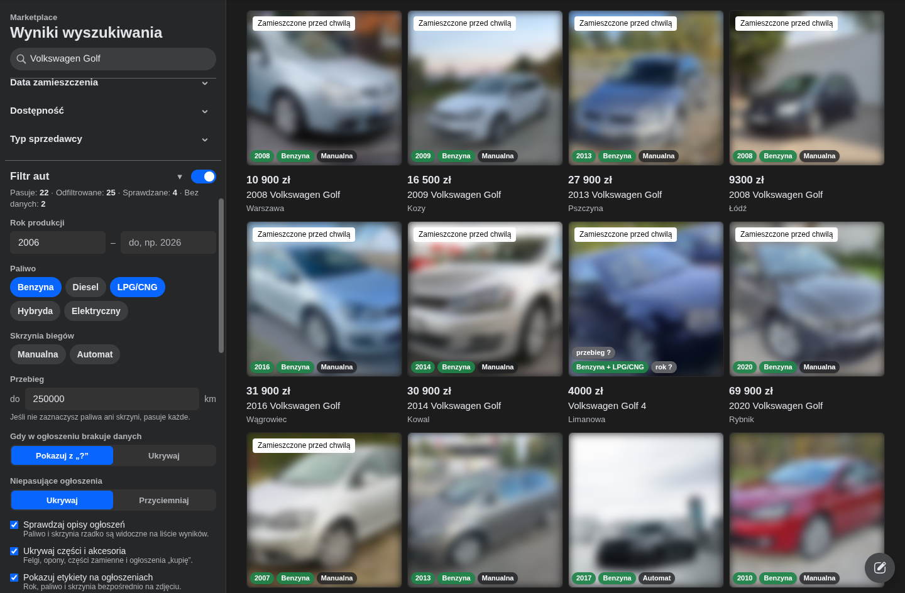
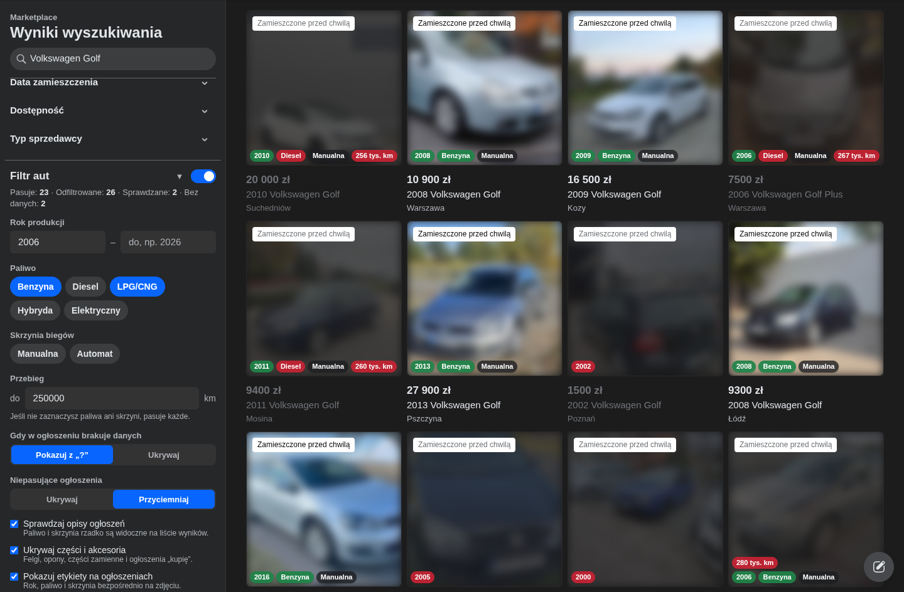
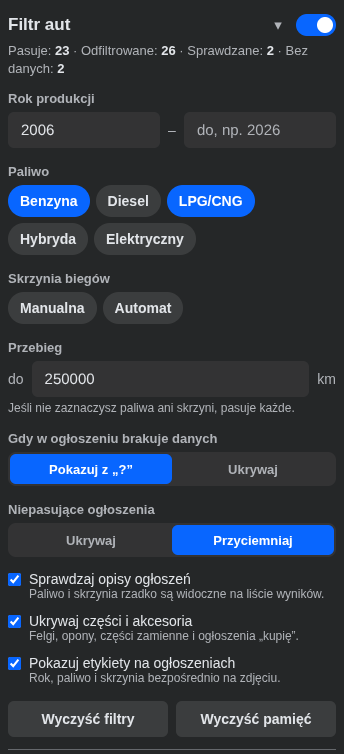
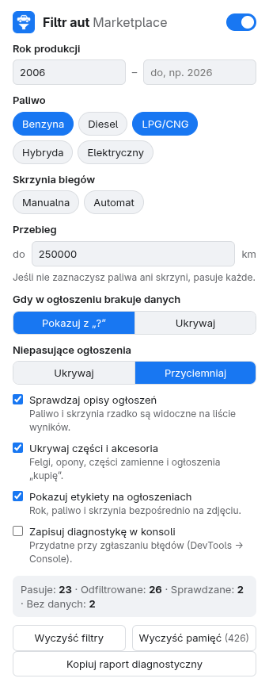
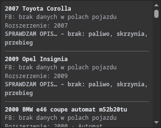

<div align="center">

# Filtr aut – Facebook Marketplace

**Rozszerzenie do Chrome / Edge / Brave / Opery, które filtruje ogłoszenia samochodów
na Facebook Marketplace po roku produkcji, paliwie, skrzyni biegów i przebiegu –
także wtedy, gdy sprzedający nie wypełnił pól pojazdu.**

[](#licencja)

</div>

---

## Zrzuty

<div align="center">
  
  <p><em>Sekcja „Filtr aut” w lewym pasku Marketplace. Ustawione: od 2006, benzyna/LPG, przebieg do 250 000 km.</em></p>
</div>

<div align="center">
  
  <p><em>Tryb „Przyciemniaj”: czerwona etykieta = powód odrzucenia (rocznik, paliwo, przebieg).</em></p>
</div>

<div align="center">
  
  
  <p><em>Panel w pasku Marketplace i okno ustawień pod ikoną rozszerzenia.</em></p>
</div>

> Zdjęcia ogłoszeń na zrzutach są celowo rozmyte.

---

## Co potrafi

| Filtr | Szczegóły |
| ----- | --------- |
| **Rok produkcji** | od–do, np. „od 2006” |
| **Paliwo** | benzyna, diesel, LPG/CNG, hybryda, elektryczny |
| **Skrzynia biegów** | manualna / automat |
| **Przebieg** | maksymalny, w km |

Najważniejsze: **rozszerzenie czyta też opis ogłoszenia.** Na liście wyników Facebook pokazuje
tylko cenę, tytuł, miasto i przebieg – paliwo i skrzynię widać dopiero w treści ogłoszenia.
Rozszerzenie pobiera je w tle, więc filtr działa nawet wtedy, gdy sprzedający zostawił
pola puste albo wpisał „Inne”.

Rozpoznawane są między innymi:

- `1.9 TDI`, `320d`, `1.4 TSI` → diesel / benzyna,
- `1.8 + LPG`, `B+G`, `butla gazu`, `serwis gazu`, `sekwencyjny gaz`, `instalacja gazowa BRC` → benzyna + LPG,
- `skrzynia automatyczna`, `S-tronic`, `DSG`, `6-biegowa` → automat / manualna,
- `Rok produkcji: 2012`, `2006r.`, `z 2006 roku` → rok,
- `Przebieg: 180 tys.`, `345.000 przebiegu` → przebieg.

Pułapki są pomijane: „klimatyzacja automatyczna”, „elektryczne szyby”, „amortyzatory gazowe”,
„skrzynia sekwencyjna”, „pedał gazu”, „przycisk gazu”, „bez LPG”, „nie ma automatu” –
a także daty, które nie są rokiem produkcji: „kupione w 2019 roku”, „ubezpieczenie do 5 maja 2027 roku”.

---

## Instalacja

1. Pobierz kod: na GitHubie **Code → Download ZIP** i rozpakuj (albo `git clone`).
2. Otwórz w przeglądarce `chrome://extensions` (w Edge: `edge://extensions`).
3. Włącz **Tryb dewelopera** (przełącznik w prawym górnym rogu).
4. Kliknij **Załaduj rozpakowane** i wskaż rozpakowany folder (ten z plikiem `manifest.json`).
5. Przypnij ikonę rozszerzenia do paska (ikona puzzla → pinezka).

Jeśli Facebook był już otwarty – odśwież kartę.

---

## Użytkowanie

1. Wejdź na Facebook Marketplace i wyszukaj auta (kategoria **Pojazdy → Samochody**
   albo wyszukiwanie „passat”).
2. W lewym pasku Marketplace, pod filtrami Facebooka, pojawi się sekcja **Filtr aut**.
   Ustaw rok, paliwo, skrzynię i przebieg – zmiany działają od razu, a w nagłówku sekcji
   widać, ile ogłoszeń pasuje, ile odfiltrowano i ile jest jeszcze sprawdzanych.
   Sekcję można zwinąć kliknięciem w nagłówek.
3. Gdy lewego paska nie ma (wąskie okno), w lewym dolnym rogu pojawia się licznik –
   kliknięcie tekstu włącza / wyłącza filtr, a przycisk **Filtry** otwiera panel ustawień.
   Te same ustawienia są też pod ikoną rozszerzenia.

### Etykiety na ogłoszeniach

| Kolor | Znaczenie |
| ----- | --------- |
| zielony | wartość pasuje do filtra |
| czerwony | wartość nie pasuje – powód odrzucenia |
| szary `?` | tej informacji nie udało się znaleźć w ogłoszeniu |
| niebieski | rozszerzenie właśnie sprawdza opis ogłoszenia |
| ciemny | informacja, której nie filtrujesz |

### Opcje

- **Ogłoszenia bez tych danych** – co zrobić, gdy np. filtrujesz po skrzyni, a w ogłoszeniu
  nigdzie jej nie podano: pokazać (z etykietą „?”) albo ukryć.
- **Niepasujące ogłoszenia** – ukrywać całkowicie albo tylko przyciemniać
  (po najechaniu myszką widać je normalnie, razem z powodem odrzucenia).
- **Sprawdzaj opisy ogłoszeń** – bez tej opcji filtr korzysta tylko z tytułu i karty ogłoszenia.
- **Wyczyść pamięć** – wyniki sprawdzania ogłoszeń są zapamiętywane na 7 dni, żeby nie
  pobierać ich ponownie; ten przycisk je usuwa.

---

## Diagnostyka – dlaczego ogłoszenie zostało odfiltrowane

W sekcji **Diagnostyka** panelu (albo w oknie pod ikoną rozszerzenia) widać dla
każdego sprawdzonego ogłoszenia:

- **FB pokazuje** – dane, które Facebook sam zwraca dla tego auta (paliwo, skrzynia,
  przebieg) oraz fragment opisu,
- **Rozszerzenie** – rok, paliwo, skrzynię i przebieg wyciągnięte z tych danych,
- **Werdykt** – `PASUJE` / `ODRZUCONE` / `BEZ DANYCH` z powodem, np.
  *„ODRZUCONE – paliwo: Diesel (wybrano: Benzyna, LPG/CNG)”*.

<div align="center">
  
  <p><em>Log diagnostyczny w panelu – widać dane z Facebooka i powód odrzucenia.</em></p>
</div>

Przycisk **Kopiuj log do schowka** (w panelu) albo **Kopiuj log diagnostyczny**
(w oknie pod ikoną) zapisuje cały log jako tekst – można go wkleić do zgłoszenia
na GitHubie. Opcja **Loguj do konsoli** dodaje te same wpisy do konsoli przeglądarki
(DevTools → Console), wraz z fragmentem opisu ogłoszenia.

---

## Jak to działa

1. Z karty ogłoszenia czytany jest tytuł (Facebook dla aut generuje go jako
   „2015 Volkswagen Golf”), przebieg i to, co widać w tytule (np. „1.9 TDI”, „Automat”, „DSG”).
   Jeśli to wystarcza do decyzji, nic więcej nie jest pobierane.
2. W przeciwnym razie rozszerzenie pobiera dane ogłoszenia **tym samym zapytaniem, którego
   używa Facebook po otwarciu ogłoszenia** – tylko dla ogłoszeń widocznych na ekranie
   (lub tuż poniżej), maks. 2 naraz, z przerwami. Najpierw używane są pola pojazdu
   wypełnione przez sprzedającego, a jeśli ich brak (albo paliwo to „Inne”) – opis.
3. Facebook co jakiś czas zmienia to zapytanie. Rozszerzenie zapamiętuje jego aktualną
   wersję za każdym razem, gdy otworzysz dowolne ogłoszenie. Jeśli zapytanie przestanie
   działać, panel poprosi o otwarcie jednego ogłoszenia – to wystarczy, żeby filtr
   znów zadziałał.

---

## Prywatność

Wszystko dzieje się lokalnie w przeglądarce.

- Rozszerzenie **nie wysyła nigdzie żadnych danych** i nie ma żadnego serwera.
- Łączy się wyłącznie z `facebook.com`, tak samo jak przy ręcznym otwieraniu ogłoszeń.
- Uprawnienia to tylko `storage` (zapamiętywanie ustawień i wyników odczytanych
  z ogłoszeń) – bez dostępu do historii przeglądarki i bez plików użytkownika.

---

## Ograniczenia

- Rozpoznawanie z opisu to heurystyka – przy nietypowo napisanych ogłoszeniach może się
  pomylić albo nic nie znaleźć (wtedy pojawia się „?”).
- Facebook co jakiś czas zmienia wygląd strony; jeśli filtr przestanie działać,
  zgłoś problem w Issues.
- Gdy Facebook zacznie ograniczać liczbę zapytań, sprawdzanie opisów wstrzymuje się
  na 3 minuty (informacja pojawia się w liczniku).
- Działa na `www.facebook.com` (i `web.facebook.com`) w przeglądarkach opartych na Chromium.
  Nie działa w aplikacji mobilnej ani na `m.facebook.com`.

---

## Dla programistów

```
src/core.js      – parsowanie i logika filtrów (bez DOM, testowane w Node)
src/content.js   – integracja ze stroną Marketplace, pobieranie danych ogłoszeń, diagnostyka
src/panel.js     – panel filtrów wstawiany w lewy pasek Marketplace (Shadow DOM)
src/page-hook.js – działa w kontekście strony; podgląda zapytanie GraphQL Facebooka o ogłoszenie
src/content.css  – ukrywanie / przyciemnianie, etykiety, licznik
popup/           – okno ustawień pod ikoną rozszerzenia
tests/           – testy
```

```sh
npm test                        # testy jednostkowe parsera (Node 18+)
npm install && npm run test:e2e # test end-to-end w Chromium z atrapą strony Marketplace
```

Test end-to-end ładuje rozszerzenie do Chromium (Playwright) i podstawia sztuczne strony
`facebook.com` (także odpowiedzi API), więc nie potrzebuje konta ani internetu.

---

## Licencja

MIT – zobacz [LICENSE](LICENSE).
